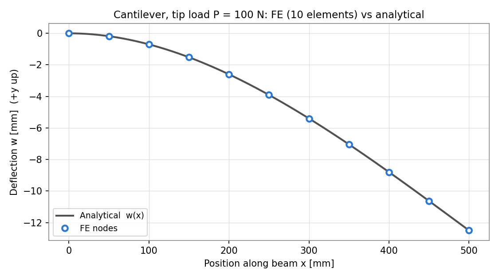
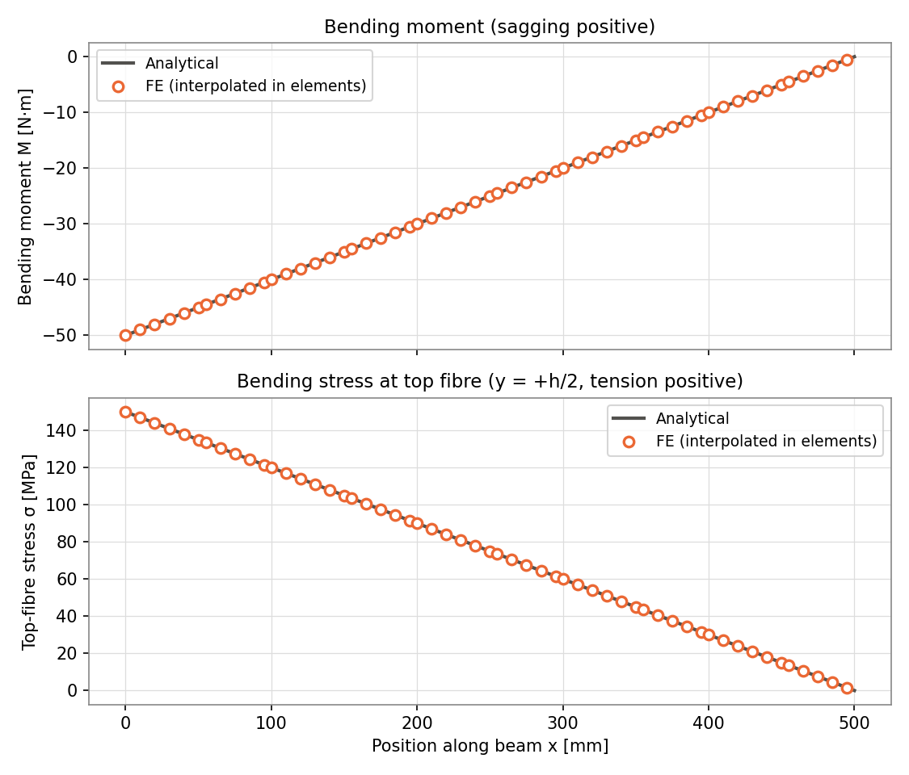
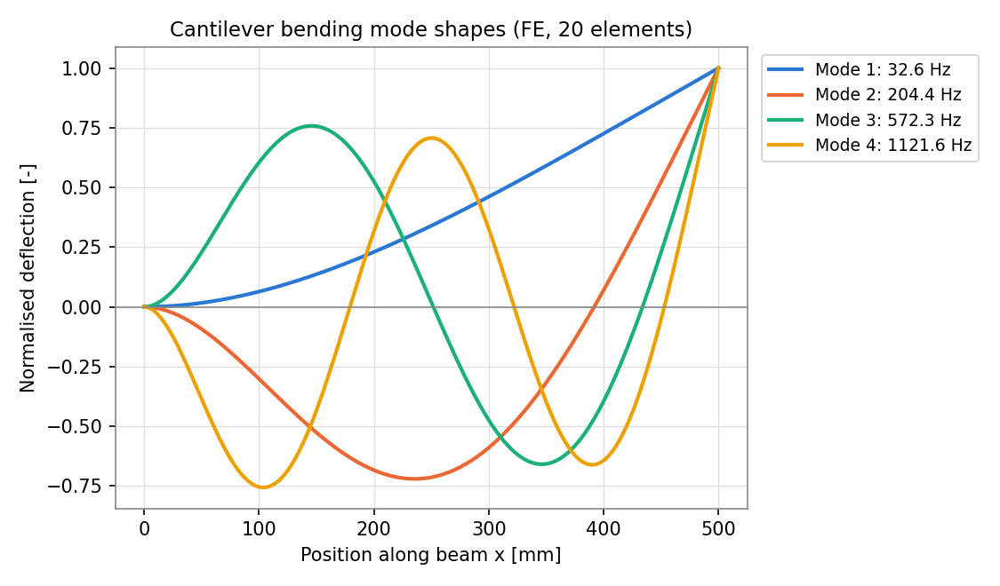
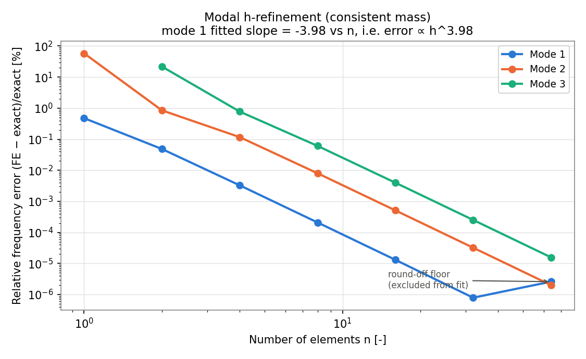

# beam-fea results summary

_Generated by `python scripts/run_all.py`. Do not edit by hand._

Reference problem: steel cantilever, L = 500 mm, b = 20 mm, h = 10 mm, tip load P = 100 N downward.

## 1. Hand calculations (closed-form Euler-Bernoulli)

| quantity | value | unit |
|---|---|---|
| Second moment of area I = b h³/12 | 1666.67 | mm⁴ |
| Tip deflection P L³/(3EI) | 12.5000 | mm |
| Tip rotation P L²/(2EI) | 0.03750 | rad |
| Root bending moment P L | 50.00 | N·m |
| Root max bending stress M c / I | 150.00 | MPa |
| Mid-span top-fibre stress | 75.00 | MPa |
| Max transverse shear stress 1.5 V / A | 0.750 | MPa |
| Bending natural frequency f1 | 32.615 | Hz |
| Bending natural frequency f2 | 204.396 | Hz |
| Bending natural frequency f3 | 572.315 | Hz |

## 2. Static verification: FE vs analytical

| case | quantity | n | FE | analytical | unit | rel. error [%] |
|---|---|---|---|---|---|---|
| cantilever_tip_load | tip_deflection | 1 | 12.5 | 12.5 | mm | -4.26e-14 |
| cantilever_tip_load | tip_deflection | 2 | 12.5 | 12.5 | mm | -4.26e-14 |
| cantilever_tip_load | tip_deflection | 5 | 12.5 | 12.5 | mm | -1.71e-13 |
| cantilever_tip_load | tip_deflection | 10 | 12.5 | 12.5 | mm | +1.31e-10 |
| cantilever_tip_load | tip_deflection | 20 | 12.5 | 12.5 | mm | +7.48e-10 |
| cantilever_tip_load | tip_deflection | 50 | 12.5 | 12.5 | mm | +3.51e-08 |
| cantilever_tip_load | tip_rotation | 10 | 0.0375 | 0.0375 | rad | +1.34e-10 |
| cantilever_tip_load | reaction_force | 10 | 100 | 100 | N | +8.28e-11 |
| cantilever_tip_load | reaction_moment | 10 | 50 | 50 | N*m | +1.20e-10 |
| cantilever_tip_load | root_top_stress | 10 | 150 | 150 | MPa | +1.20e-10 |
| cantilever_tip_load | midspan_top_stress | 10 | 75 | 75 | MPa | +1.54e-10 |
| cantilever_udl | tip_deflection | 10 | 4.6875 | 4.6875 | mm | +1.38e-10 |
| simply_supported_central_load | midspan_deflection | 10 | 0.78125 | 0.78125 | mm | +1.53e-11 |

Maximum |σ| (von Mises, uniaxial) = 150.000 MPa at x = 0.0 mm.

The tip-load deflection is exact for every mesh (including 1 element) because the exact solution is a cubic, which Hermite elements reproduce; the tiny non-zero errors are floating-point round-off.

## 3. Modal verification (20 elements)

| mode | f FE [Hz] | f analytical [Hz] | error [%] |
|---|---|---|---|
| 1 | 32.6152 | 32.6152 | +5.47e-06 |
| 2 | 204.3966 | 204.3961 | +2.10e-04 |
| 3 | 572.3245 | 572.3151 | +1.64e-03 |
| 4 | 1121.5793 | 1121.5092 | +6.25e-03 |
| 5 | 1854.2492 | 1853.9351 | +1.69e-02 |

## 4. Modal h-refinement

| n elements | mode 1 error [%] | mode 2 error [%] | mode 3 error [%] |
|---|---|---|---|
| 1 | +4.754e-01 | +5.797e+01 | n/a |
| 2 | +4.834e-02 | +8.486e-01 | +2.182e+01 |
| 4 | +3.271e-03 | +1.165e-01 | +7.742e-01 |
| 8 | +2.083e-04 | +7.996e-03 | +6.082e-02 |
| 16 | +1.309e-05 | +5.108e-04 | +3.975e-03 |
| 32 | +7.875e-07 | +3.209e-05 | +2.512e-04 |
| 64 | +2.586e-06 | +2.010e-06 | +1.574e-05 |

Fitted convergence rate for mode 1: **error ∝ h^3.978** (fit over n = [2, 4, 8, 16, 32]).
 Excluded n = [64]: error stopped decreasing (floating-point round-off floor).

All FE frequencies above the exact values (converge from above): True.

## 5. ANSYS Mechanical comparison

**ANSYS data pending.** Follow `ansys/ANSYS_GUIDE.md`, fill in `ansys/ansys_results.csv`, then re-run `python scripts/run_all.py`.
